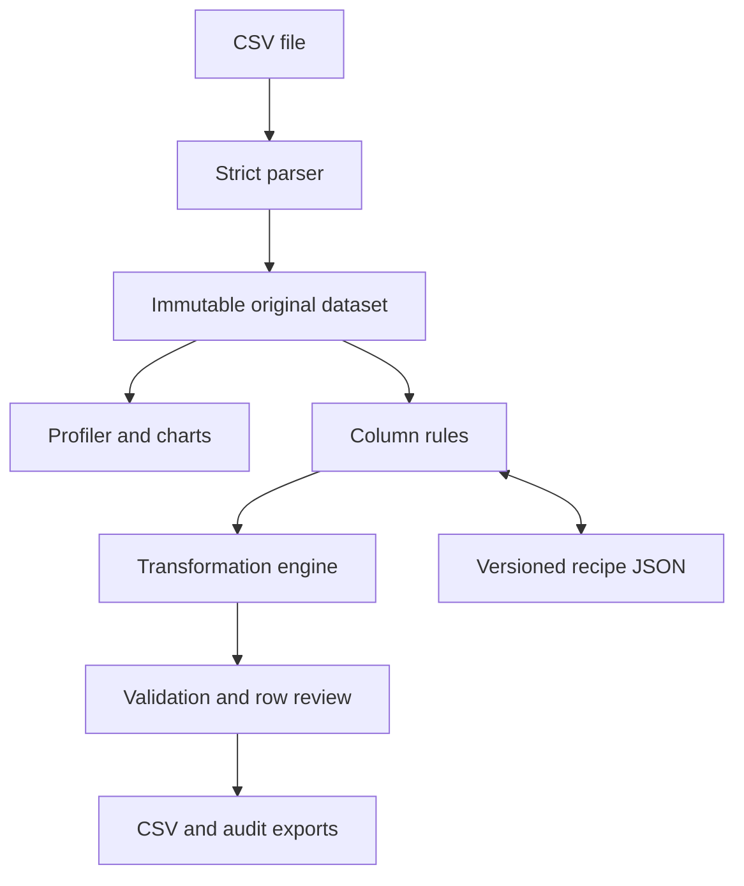

# Architecture and engineering decisions

DataClinic is a browser-first CSV inspection and cleaning workbench. The shipped
application has no backend or AI API dependency. Dataset contents stay in memory
on the current device, and reload clears them. A separate Python CLI performs
inspection only; it does not power the web app.

## Boundaries

- `web/profile.js`: strict CSV parsing, profiling, interpolated quartiles and IQR flags.
- `web/advanced.js`: versioned rule validation, deterministic transformations,
  validation findings, source-record tracking, and histogram aggregation.
- `web/clean.js`: legacy cleaning API retained for regression compatibility and
  protected CSV serialization used by the studio.
- `web/app.js`: DOM rendering, transient recipe history, downloads and file input.
- `dataclinic/`: independent dependency-free Python inspection CLI.

## Transformation semantics

Each preview starts from a copy of the original. First, per-column trim and
missing-token normalization run. Next, all drop-row predicates run. Filling then
uses the surviving observations, before final deduplication. Numeric medians use
finite decimal/scientific numbers; mode uses exact strings with first-observed
tie breaking. Custom replacements can fill an entirely empty column. ID columns
reject inferred median/mode fills. Column meaning is validation metadata, not a
coercion instruction: `001` remains `001`, and declared dates must use YYYY-MM-DD.

Validation flags required, unique, finite-number, calendar-date and numeric-range
violations. It never deletes an invalid record automatically. Missing values are
ignored by type/range/uniqueness rules unless Required is selected. Unique counts
repeated occurrences after the first. Multiple violated rules can flag one cell;
violation totals count rule failures, not distinct invalid cells.

## Traceability and memory limits

Every surviving row retains its original CSV record number (header is record 1).
Records are not physical line numbers because quoted fields can contain newlines.
Cell edit events record step-level before/after values; one cell can have more
than one event. Distinct changed-cell counts and removal counts cover the entire
input. Detailed edit events and validation issues are capped at 2,000; the UI
paginates 20 at a time and discloses truncation. The audit includes source-row
mapping. Raw validation issue indices refer to that dataset's record positions;
map cleaned positions through `sourceRows` to recover original record numbers.

Limits: 5 MiB UTF-8 CSV, 50,000 data records and 200 columns. Processing currently
runs on the browser main thread; large or wide files can pause interaction. A Web
Worker and streaming parser are future work, not shipped capabilities.

## Trust and export policy

All dataset strings render through textContent, never HTML interpolation. Recipes
are bounded JSON, not executable code, and require exact column order and names.
They include rule settings and custom replacement values but exclude dataset rows.
Only imported known fields are retained. Undo keeps up to 30 in-memory settings
snapshots; it does not accumulate transformations on already cleaned data.

CSV export quotes every field, doubles embedded quotes, uses CRLF and UTF-8 BOM,
and prefixes potentially executable spreadsheet values with an apostrophe. This
includes headers and negative numbers. This deliberate policy can alter exported
strings; the preview stays unchanged and the audit records the protection count.
CSV formula handling varies among spreadsheet software, so exports should still
be reviewed in the intended consumer.

## Honest limitations

This is deterministic data tooling, not an AI model or an ML readiness predictor.
There is no automatic leakage detector, database persistence, user sharing or
Excel workbook support. Imputation is computed over the loaded dataset; for ML,
fit imputation on training data only. Ranges and ID declarations require domain
judgment. Missing-token assumptions can misclassify legitimate categories such as
`NA`; this release documents the tokens rather than claiming universal correctness.
The Python and JavaScript profilers are separate implementations and should not
be described as one shared backend.
